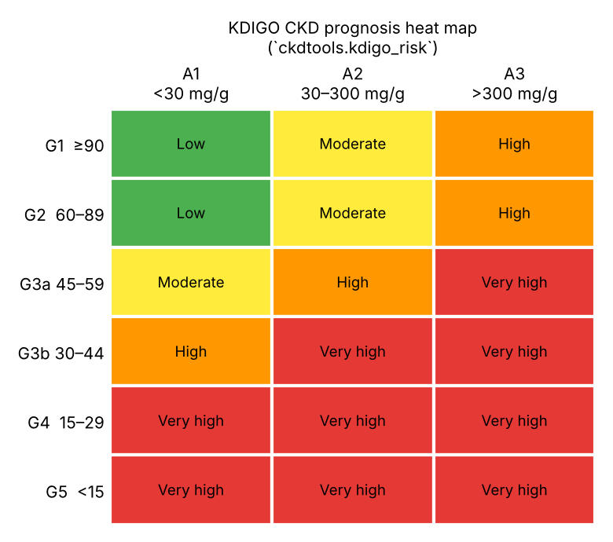
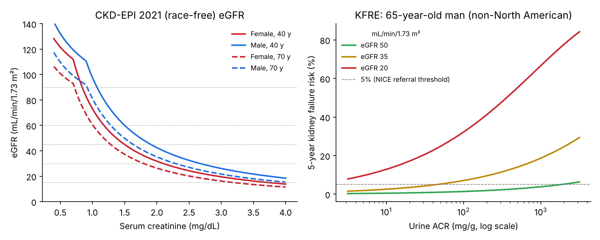

# ckdtools: Kidney Function Calculators for Clinical Research


A small, **dependency-free and fully unit-tested** Python package for the kidney calculations used every day in
internal medicine and nephrology research:

| Function | What it computes | Source |
|---|---|---|
| `egfr_creatinine` | eGFR, race-free **CKD-EPI 2021** creatinine equation | Inker et al., *NEJM* 2021 |
| `egfr_cystatin` | eGFR, **CKD-EPI 2012** cystatin C equation | Inker et al., *NEJM* 2012 |
| `egfr_creatinine_cystatin` | eGFR, **CKD-EPI 2021** creatinine–cystatin C equation (preferred when both are available) | Inker et al., *NEJM* 2021 |
| `gfr_category`, `albuminuria_category`, `classify` | **KDIGO** G1–G5 / A1–A3 staging and prognosis heat map | KDIGO 2024 CKD guideline |
| `kfre` | 2- and 5-year risk of kidney failure, **4-variable Kidney Failure Risk Equation** | Tangri et al., *JAMA* 2011, 2016 |

**Why another eGFR package?** Spreadsheet formulas for eGFR are a common source of silent errors in clinical
research. Typical mistakes are wrong units, the retired race coefficient, and the wrong KFRE calibration. This
package makes each equation explicit, cites its source in the docstring, handles SI units, and checks every
coefficient and KDIGO boundary in a test suite that runs on every commit.

## Install

```bash
pip install git+https://github.com/alirezajavan-sys/ckd-toolkit.git
```

## Use it in Python

```python
from ckdtools import egfr_creatinine, egfr_creatinine_cystatin, classify, kfre

egfr = egfr_creatinine(scr=2.1, age=67, sex="male")             # 33.9 mL/min/1.73 m²
egfr_si = egfr_creatinine(scr=160, age=54, sex="female", unit="umol/L")

classify(egfr, acr=450)
# {'stage': 'G3bA3', 'risk': 'Very high', 'gfr_category': 'G3b', 'albuminuria_category': 'A3', ...}

kfre(age=67, sex="male", egfr=egfr, acr=450, years=5)           # 0.145 → 14.5% five-year risk
kfre(age=67, sex="male", egfr=egfr, acr=50.9, acr_unit="mg/mmol", years=2)
```

Works on whole cohorts with pandas:

```python
df["egfr"] = [egfr_creatinine(s, a, x) for s, a, x in zip(df.creatinine, df.age, df.sex)]
df["kfre_5y"] = [kfre(a, x, e, r) for a, x, e, r in zip(df.age, df.sex, df.egfr, df.acr)]
```

## Use it from the command line

```console
$ ckdtools --age 54 --sex female --scr 160 --scr-unit umol/L --scys 1.6 --acr 35 --acr-unit mg/mmol
eGFR (mL/min/1.73 m²)
  CKD-EPI 2021 creatinine                32.9
  CKD-EPI 2012 cystatin C                39.8
  CKD-EPI 2021 creatinine-cystatin C     36.6

KDIGO (using CKD-EPI 2021 creatinine-cystatin C)
  Stage   G3bA3  — Moderately to severely decreased (30–44); Severely increased (>300 mg/g; >30 mg/mmol)
  Risk    Very high

Kidney Failure Risk Equation (non-north-american calibration)
  2-year risk    2.6%
  5-year risk    9.6%
```

<p align="center">
  
  
</p>

## Design decisions worth knowing

* **Race-free by design.** Only the 2021 refit of the creatinine equation is implemented, following the
  NKF-ASN Task Force recommendation (Delgado et al., 2021).
* **KFRE calibration defaults to non-North American** (baseline survival 0.9832 at 2 years, 0.9365 at 5 years).
  This is appropriate for Europe, the Middle East, Asia and Oceania. Use `region="north_american"` for the US and
  Canada (0.9750 / 0.9240).
* **KFRE warns outside its validated range** (eGFR ≥ 60), and every equation rejects patients younger than 18.
* **Units:** creatinine in mg/dL or µmol/L (÷ 88.42); ACR in mg/g or mg/mmol (× 8.84).

## Tests

```bash
pip install -e ".[dev]"
pytest          # 40 tests: hand-calculated values, KDIGO boundaries, spline continuity, unit equivalence, CLI
python docs/make_figures.py
```

## References

1. Inker LA, Eneanya ND, Coresh J, et al. New creatinine- and cystatin C–based equations to estimate GFR without
   race. *N Engl J Med.* 2021;385:1737–1749.
2. Inker LA, Schmid CH, Tighiouart H, et al. Estimating glomerular filtration rate from serum creatinine and
   cystatin C. *N Engl J Med.* 2012;367:20–29.
3. Kidney Disease: Improving Global Outcomes (KDIGO) CKD Work Group. KDIGO 2024 Clinical Practice Guideline for
   the Evaluation and Management of Chronic Kidney Disease. *Kidney Int.* 2024;105(4S):S117–S314.
4. Tangri N, Stevens LA, Griffith J, et al. A predictive model for progression of chronic kidney disease to kidney
   failure. *JAMA.* 2011;305(15):1553–1559.
5. Tangri N, Grams ME, Levey AS, et al. Multinational assessment of accuracy of equations for predicting risk of
   kidney failure: a meta-analysis. *JAMA.* 2016;315(2):164–174.
6. Delgado C, Baweja M, Crews DC, et al. A unifying approach for GFR estimation: recommendations of the NKF-ASN
   Task Force on reassessing the inclusion of race in diagnosing kidney disease. *Am J Kidney Dis.* 2022;79(2):268–288.

> **Disclaimer:** for research and education. Not a medical device; not a substitute for clinical judgement.

## Author

**Alireza Javan**. [GitHub profile](https://github.com/alirezajavan-sys)
